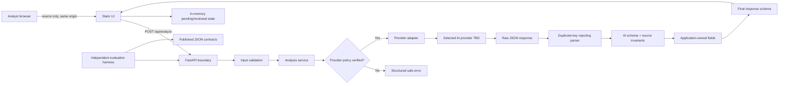

# Implementation Plan: AI-Powered Security Code Review Assistant

**Branch**: `001-ai-security-code-review`
**Date**: 2026-11-05
**Spec**: [spec.md](spec.md)

## Summary

Plan a single-user local browser application that accepts bounded Python source as untrusted text, sends it to a provider adapter only when a provider can enforce the clarified processing-only/no-retention/no-training policy, validates the model's raw JSON before composing and validating an application-owned response, and presents the result as inert text for explicit analyst review. Source, results, and review state exist only in active-process/browser memory. No provider is selected in this plan. A provider-policy gate fails closed until enforceable evidence for the required policy is available.

The plan covers the future three-layer evaluation harness and its approved semantic rubric and 85% threshold, but does not create its dataset. The implementation should remain a small Python application with one same-origin API, a plain browser UI, and a separately implemented evaluator.

## Technical Context

**Language/Version**: Python 3.12+ (planning choice; package/runtime minimum to be recorded in project metadata during implementation)
**Primary Dependencies**: FastAPI for HTTP/UI serving; Pydantic v2 in strict mode for typed boundaries; `jsonschema[format]` for final JSON Schema validation with enabled `FormatChecker` and its RFC 3339 date-time checker dependency; HTTPX behind a provider adapter. Provider SDK remains undecided.
**Storage**: None for submissions, results, review state, or credentials. Static application assets only; no database, browser storage, application cache, or telemetry.
**Testing**: pytest; FastAPI TestClient/httpx for API contracts; Hypothesis for boundary/property cases; Playwright for browser safety and review flow; jsonschema for independent evaluation validation; Ruff, Bandit, and pip-audit as quality/security gates.
**Target Platform**: Local desktop browser on Windows, macOS, or Linux; server binds to loopback only.
**Project Type**: Single Python web application with same-origin static frontend and independent evaluation tooling.
**Performance Goals**: Reject invalid/oversized requests before provider I/O. No response-time SLO is specified because provider latency is external; show a pending state until completion.
**Constraints**: 100,000 UTF-8 source bytes; at most 2,000 addressable logical lines; incomplete Python accepted as text; submitted source is never parsed for execution or executed; no retry/cancel; no accounts; provider policy must be proven before source transmission; no source/result persistence.
**Scale/Scope**: One analyst and one Python source submission per request; no batch/repository scans, collaboration, accounts, persistence, or non-Python language support.

### Specification synchronization gate

The clarification list and FR-014/FR-026 establish no retry/cancellation and a structured JSON error envelope. The specification synchronization update now removes the stale Q9/Q10 unresolved language and repeats those decisions in the assumptions. No Clarify decision remains open. This correction does not change the architecture or provider decision.

## Constitution Check

**Pre-design gate**: The Part-1B `.specify/memory/constitution.md` is approved by the human project owner (version 0.1, approved 2026-11-05). It remains subordinate to explicit human-approved assignment requirements and does not imply instructor or organizational approval.

**Design re-check**: The planned architecture aligns with the approved project principles and explicit specification constraints: security-first boundaries, transient data handling, strict input/output validation, independent evaluation, no source execution, inert rendering, human review, and traceability.

## Architecture and responsibilities



### Module responsibilities

| Module | Responsibility and constraints |
|---|---|
| `api/app.py`, `api/routes.py` | Create app, serve static UI and `POST /api/analyze`; enforce an independent maximum raw HTTP JSON entity size of 600,128 bytes before decoding. The six-times calculation accommodates worst-case JSON escaping of a 100,000-byte source string, with a small allowance for the compact JSON object structure. The browser client sends compact JSON; the raw entity cap may reject an otherwise valid source submission if its JSON representation contains excessive whitespace. After decoding, enforce source limits. Also enforce loopback/Host/Origin protections, same-origin policy, request/response content types, and safe error mapping. No source-body logging. |
| `schemas/` and `contracts/` | Versioned AI-generated, final-result, and error contracts. `additionalProperties: false`; strict types; cross-field checks live in validation code. |
| `validation/input.py` | After JSON decoding, reject blank/whitespace-only source, `len(source_code.encode("utf-8")) > 100_000`, or >2,000 logical lines before provider I/O. Count LF, CRLF, CR consistently; final terminator adds no addressable line. Preserve the decoded source string exactly. |
| `validation/model_output.py` | Parse exactly one JSON document; reject duplicate keys at all nesting levels and non-standard numeric constants; validate strict schema, unique IDs as applicable, `line_end >= line_start`, `line_end <= source_line_count`, evidence, and assessment. Never render rejected content. |
| `services/analyzer.py` | Orchestrate validation, policy gate, provider call, model validation, application field generation, final validation, and typed failure outcomes. No persistence or retry. |
| `providers/protocol.py`, `providers/` | Narrow provider interface and request adapter, with provider choice behind configuration. Do not implement a provider until policy proof is approved; secrets loaded only from environment and attached only to auth transport, never prompt/log/UI. No automatic retries. |
| `security/prompt.py` | Fixed analysis instructions; source delimited and explicitly untrusted; no tools, shell, filesystem or other action privileges; do not include secrets. Prompt wording is defense-in-depth, not a guarantee against model influence. |
| `web/` | Plain HTML/CSS/JavaScript served same-origin. Render source/finding text via text nodes (`textContent`/DOM text APIs); no `innerHTML` with untrusted content. Do not make untrusted findings links. In-memory source/result/review state only; reload/close clears it. |
| `evaluation/` | Independent structural, invariant/property, semantic and aggregation implementation. It must independently parse/reject duplicate keys and validate public contracts; do not call application validation helpers. Do not add evaluation samples in this plan. |
| `tests/` | Unit, API contract, provider-boundary, property, browser E2E, and independent harness tests. Provider calls are mocked except for separately approved gated verification. |

### Request and response sequence

```mermaid
sequenceDiagram
  actor A as Analyst
  participant B as Browser UI
  participant S as API/Analysis Service
  participant P as Provider Policy Gate
  participant M as Provider Adapter
  A->>B: Enter Python source and submit
  B->>S: POST /api/analyze {source_code}
  S->>S: Validate non-empty, byte/line limits
  alt input invalid
    S-->>B: error envelope (invalid_input)
  else valid input
    S->>P: Check configured policy evidence
    alt policy absent or insufficient
      P-->>B: error envelope (configuration_failure)
    else verified policy
      S->>M: Send source once; no retry
      M-->>S: Raw model response
      S->>S: Reject duplicate keys; parse and validate AI schema/invariants
      S->>S: Add IDs/metadata, derive assessment, validate final schema
      S-->>B: Successful final JSON object
      B->>B: Render inert text; set review=pending
      A->>B: Explicitly mark reviewed
      B->>B: Set review=reviewed in current memory only
    end
  end
```

## Design decisions and security controls

1. **Boundary-first validation**: enforce an independent maximum raw HTTP JSON entity size of 600,128 bytes before decoding. The six-times calculation accommodates worst-case JSON escaping of a 100,000-byte source string, with a small allowance for the compact JSON object structure; it does not bound arbitrary JSON whitespace. The browser client sends compact JSON, while excessive whitespace can cause the raw entity cap to reject an otherwise valid source submission. After decoding, measure the original `source_code` as UTF-8 bytes and reject values over 100,000 bytes or over 2,000 addressable logical lines before provider use. Accept incomplete syntax. Do not call `compile`, `exec`, `eval`, imports, subprocess, or shell on submission content.
2. **Strict model boundary**: use strict typed models with unknown fields forbidden. First parse raw provider text with a duplicate-aware JSON decoder; reject duplicate object names at every nesting depth, trailing documents, NaN/Infinity, malformed JSON, wrong top-level shape, missing/extra keys, and wrong primitive types. JSON Schema documents the external shape; custom validators enforce `line_end >= line_start`, `line_end <= submitted source_line_count`, unique IDs, finite confidence and cross-field assessment. Validate `analysis_timestamp` with JSON Schema `format: date-time` and an enabled `FormatChecker` when validating the final response. Include the `format` extra so the RFC 3339 date-time checker dependency is installed; confirm that the date-time checker is registered/enabled, since an unavailable format implementation may otherwise silently skip format validation. For exact evidence, compare it against an exact source slice covering the reported inclusive line range, retaining line terminators exactly as submitted; do not normalize line endings, whitespace, Unicode, or source text before comparison.
3. **Two response stages**: AI output contains only `analysis_summary` and model-owned finding fields. Application creates `schema_version`, `finding_id`, `overall_assessment`, and metadata, then validates the complete response. Error envelope is independent and never resembles a clean result.
4. **Provider privacy gate**: transmit nothing until configuration identifies the selected endpoint/model and there is enforceable evidence of request-only processing, no post-request retention, and no training. A model vendor's general no-training statement alone is insufficient if abuse monitoring or endpoint features retain source. No provider is selected in this plan; selection stays a blocking implementation decision until evidence and applicable endpoint terms are reviewed.
5. **Loopback browser hardening**: bind only to `127.0.0.1` (and IPv6 loopback if intentionally supported), reject unexpected Host/Origin, disable cross-origin API access, use same-origin POST, no ambient provider credential in browser, restrictive CSP and security headers, and no clickable interpretation of source/finding URLs. No login does not remove local-browser CSRF or DNS-rebinding risks.
6. **No durable state**: no DB, files, browser local/session storage, service-worker cache, request-body logs, crash-report source capture, or analytics. Keep source/results transiently in request memory and browser memory only. Clear UI data on reload/close; review state is session-only.
7. **Safe errors and logs**: map errors to the four specified error codes; messages are fixed safe text, not provider exception strings. Log only non-sensitive event category, outcome, timing and correlation identifier if approved; never source, findings, evidence, raw provider payload, authorization headers or secrets.
8. **Prompt-injection treatment**: delimit and label source as data; explicit instruction hierarchy; no tool access; least privilege; output schema validation; adversarial tests. This reduces risk but does not prove a model can never be influenced. Mandatory gate checks task override, execution/action events and secret disclosure as specified.
9. **Human review**: any successful result with findings starts pending. Only explicit UI action changes it to reviewed. No automatic review, persistence, or decision that AI findings are authoritative.

## Output/data model

See [data-model.md](data-model.md) and versioned schemas under `contracts/`. Model owns only semantic analysis fields. App owns identifiers, derived assessment, timestamps and metadata. Browser review state is not part of the JSON result and is transient.

## Test and quality strategy

| Test layer | Planned evidence |
|---|---|
| Unit | Raw JSON-body size boundary; post-decode UTF-8 source-byte and logical-line boundaries including CR/LF/CRLF; duplicate keys at nested objects; malformed/trailing JSON; strict type/enum/range/finite-number checks; `line_end >= line_start`; `line_end <= submitted source_line_count`; exact evidence comparison against unnormalized source; metadata timestamp validation with enabled JSON Schema `FormatChecker` and installed/registered date-time implementation (include invalid date-time cases to verify it is active); assessment derivation for empty/non-empty findings; safe error mapping; provider policy fail-closed. |
| API contract | Exactly one success JSON object or the exact error envelope; independent raw entity cap of 600,128 bytes with the application client using compact JSON; decoded source remains <=100,000 UTF-8 bytes and <=2,000 logical lines; schema version and ownership fields; cross-field line and assessment invariants; timestamp format checked with enabled `FormatChecker`; no source/result in error; provider not called for invalid input; no provider call on absent policy evidence; no retries. |
| Provider contract | Fake adapter asserts source placement and one call; credential only in designated auth field; sanitized exception mapping; timeout/rate-limit/provider failure distinct from clean result. Live provider testing only after policy proof and explicit setup; it is not needed for routine unit suite. |
| Property/invariant | Generated logical-line/newline combinations, byte/line boundary values, line range/evidence relationships, duplicate keys in any nesting depth; application and harness have independent validators. |
| Browser E2E | Display source/finding as text; inject script/markup/event-handler and dangerous URL strings and verify no execution/navigation; visible finding-to-line linkage; pending state persists until explicit action; review is memory-only; no retry/cancel controls. |
| Evaluation harness | Structural schema/duplicate-key validation (including independent line-range and assessment cross-field checks); install the `jsonschema[format]` date-time dependency and enable JSON Schema `FormatChecker`; invariant and property gates with the observable evidence required by spec; one-to-one semantic matching and deterministic tie-break; line IoU and component formulas; 2 reviewers/3rd adjudication; denominator preservation, >=15 coverage, `Other` case, all mandatory coverage, approved 85% threshold. Harness tests use synthetic fixtures only; no project evaluation dataset is created here. |
| Static quality/security | Ruff lint/format check, Bandit scan, dependency audit (pip-audit or equivalent), dependency lock/reproducibility check, and manual review of security-sensitive sinks. Tool findings are reported honestly and triaged; suppressions require rationale. |

### Evaluation aggregation rule

Use the specification's approved rubric unchanged. Dataset coverage and at least 15 meaningful cases are prerequisites. Every declared case remains in the denominator; failed/unscored cases remain visible, score zero, and force aggregate FAIL. Structural failures or any mandatory safety/invariant failure force FAIL regardless of semantic score. Otherwise PASS requires semantic mean >=85%. The harness reports case rows, denominator, coverage, layer results, gate evidence, score, threshold and aggregate result.

## Implementation phases (planning sequence; not started)

| Phase | Deliverable and verification focus | Depends on |
|---|---|---|
| 0. Contract and policy decisions | Freeze schemas/error status semantics; identify whether any provider can meet enforceable retention/no-training policy. No provider transmission without approval evidence. | Specification and human decision |
| 1. Package and boundary skeleton | Python package, typed settings, environment-only secret loading, app factory, loopback defaults, dependency lock and test/lint configuration. Verify no secret default and reproducible setup. | Phase 0 |
| 2. Contracts and pure validators | AI/final/error schema validators; duplicate-key decoder; input byte/logical-line validation; exact source excerpt/range checks; application field derivation. Unit/property tests first. | Phase 1 |
| 3. Provider abstraction and analysis service | Provider protocol; fail-closed policy evidence/config check; single-call adapter; no retry; sanitized errors; service orchestration and API contracts. Mocked provider tests. | Phases 1–2; provider policy evidence before live integration |
| 4. Browser UI and human review | Same-origin source editor and findings panel; inert rendering; line associations; explicit pending/reviewed control; CSP/Host/Origin protections. Browser E2E and security checks. | Phase 3 |
| 5. Independent evaluation harness | Separate validators, structural/invariant/semantic layers, deterministic matching and adjudication inputs, denominator/reporting/PASS-FAIL rules. Unit tests with synthetic cases only. | Phase 2 contracts; application interfaces |
| 6. Verification and evidence package | Run tests, Ruff, Bandit, dependency audit, browser security cases, harness self-tests; capture commands, environment, outputs, failures and repairs. Human review remains final project decision. | Phases 1–5; dataset/provider verification when available |

These phases are an architectural sequence, not task breakdowns. No tasks have been generated or implementation started.

## Requirement traceability

| Specification coverage | Planned components and verification |
|---|---|
| FR-001–FR-010, FR-013; SC-001–SC-002 | Input validator, analysis service, strict response validator; unit/property/API contract tests for types, category/severity enums, confidence, exact evidence and lines. |
| FR-011–FR-012, FR-025; SEC-005 | Separate AI/final schemas, duplicate-aware decoder and response composition; nested duplicate-key and schema contract tests. |
| FR-014, FR-020, FR-026; SEC-006; SC-007, SC-012 | Error mapper and provider adapter; failure-injection tests prove valid safe envelope, no false clean result, no automatic retry. |
| FR-015–FR-016, FR-024; SEC-007; SC-009–SC-011 | Same-origin UI and in-memory review state; browser E2E for source association, inert rendering, unsafe links and pending/reviewed transition. |
| FR-017–FR-019; SEC-001–SEC-004; SC-008 | Environment-only credential handling, no-execution boundary, prompt construction and provider-policy gate; execution sentinel, canary, log/storage inspection, captured outbound request and provider attestation evidence. |
| FR-021–FR-023; SC-003–SC-006 | Independent harness and evaluation report; harness tests cover structural, invariant/property and semantic layers, minimum/coverage, denominator, fail gates and 85%. Dataset creation remains future work. |

## Dependencies and operational assumptions

- Python runtime and pinned/locked development dependencies; no external database.
- Network access is needed only to the ultimately approved AI provider; application remains loopback-only for browser access. Do not silently broaden bind address or enable CORS.
- Provider API key is configured in environment at launch and is never exposed to browser JavaScript.
- Provider selection is intentionally deferred. Official policy documentation and actual endpoint/model settings must be checked at selection time. Current vendor terms or defaults may change, and the required zero post-request retention standard may require a special approved configuration or may be unavailable. The system must fail closed if compliance cannot be demonstrated.
- Evaluation dataset, reviewer panel, and labeled rubric are future prerequisites; this plan does not create them.

## Risks and mitigations

| Risk | Mitigation / evidence |
|---|---|
| No AI endpoint satisfies request-only/no-retention/no-training | Keep source transmission disabled; evaluate endpoint-specific enforceable controls, contractual terms or a local model deployment; do not relax approved policy without a new human decision. |
| Prompt injection can influence probabilistic model | No tools/privileges, explicit untrusted delimiters, secrets omitted, schema/source checks, adversarial mandatory gates; never claim prompt text alone guarantees immunity. |
| Model fabricates or mislocates findings/evidence | Exact excerpt and line validation rejects ungrounded claims; human review; semantic evaluation against approved labeled cases. |
| Browser XSS or local cross-origin request abuse | Text-only rendering, no untrusted links, CSP, loopback binding, Host/Origin checks, no permissive CORS, browser E2E adversarial content. |
| Sensitive content leaks through diagnostics or browser persistence | Fixed error messages, safe metadata-only logs, disable telemetry/caching, browser memory only, canary scan all controlled surfaces. |
| Third-party dependency vulnerabilities | Small dependency set, lock versions, static scan and dependency audit; review/update findings before accepting release. |

## Project Structure

### Documentation (this feature)

The planned contract set includes `analysis-request.schema.json`, `ai-response.schema.json`, `analysis-result.schema.json`, `error-response.schema.json`, `evaluation-case.schema.json`, and `http-api.md`.

```text
specs/001-ai-security-code-review/
├── spec.md
├── plan.md
├── research.md
├── data-model.md
├── quickstart.md
├── contracts/
│   ├── analysis-request.schema.json
│   ├── ai-response.schema.json
│   ├── analysis-result.schema.json
│   ├── error-response.schema.json
│   ├── evaluation-case.schema.json
│   └── http-api.md
└── tasks.md                 # Future $speckit-tasks output; not created now
```

### Planned source layout (not created by this planning phase)

```text
pyproject.toml
src/security_code_review/
├── __init__.py
├── __main__.py
├── api/{app.py,routes.py}
├── config.py
├── schemas/{ai_response.py,analysis_result.py,errors.py}
├── validation/{input.py,json_decoder.py,model_output.py,source_grounding.py}
├── services/analyzer.py
├── providers/{protocol.py,policy.py,adapter.py}
├── security/{prompt.py,headers.py}
└── web/{index.html,app.js,styles.css}
evaluation/
├── harness/{cli.py,structural.py,invariants.py,semantic.py,report.py}
└── schemas/                  # Independent evaluator schemas
tests/
├── unit/
├── contract/
├── integration/
├── browser/
└── evaluation/               # Harness tests with synthetic fixtures, not the dataset
```

**Structure Decision**: One Python package serves the browser UI and same-origin API. Evaluation tooling is a separate top-level package with its own validation path so it can independently verify application output. No application source files or evaluation dataset are part of this plan artifact set.

## Complexity Tracking

The design follows the approved project Constitution. It uses one application package and one independent evaluation package, directly justified by the requirement that harness validation be independent of application validation. No service decomposition, database, authentication system, or frontend framework is proposed.

## Plan Approval Record

- **Decision**: APPROVED
- **Approver**: Human project owner
- **Approval date**: 2026-11-05
- **Scope**: Architecture, module responsibilities, security controls, validation strategy, evaluation strategy, implementation phases, and project structure.

This records project-owner approval only; it does not imply approval by BITS Pilani or the instructor. Approval authorizes proceeding to task generation and does not automatically authorize implementation. The approved specification and Constitution remain authoritative. Provider selection and verification of the required privacy policy remain blocking requirements before any submitted source is transmitted to an AI provider.
